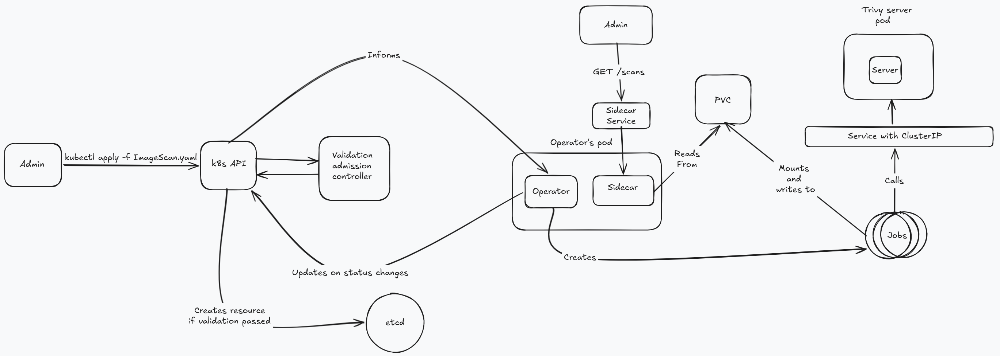

# Summary

## 1. High level design

Whenever someone wants to create an ImageScan resource, they make an API request to the k8s API. The API does auth+authorization
and calls our validating webhook. As per the requirements of this task, our webhook does 2 things:

1. On Create, we check that the ImageScan resource has a namespace selector and a pod selector. If this check passes, then we check if the
namespace and the pods selectors are valid, i.e. there is at least 1 pod that exists given the combination of namespace and pods label selectors.
If either of these checks fails, then we reject the request.

2. On Update, we check if the .spec(desired state) is being modified. If yes, then we reject the request. This ensures our Custom Resource (CR)
is immutable.

Once the validation passes, the object is persisted into etcd. The k8s API "informs" the operator that a new ImageScan CR has been created
and the reconcile logic is triggered. The operator is responsible for fetching all the pods from the selected namespaces.
Then, it extracts the images from the containers and the initContainers.

After that, it dedupes the extracted images. For each image, it creates a Job resource. Each Job resource scans a single image and mounts a PVC
called `scan-results`. Each scan is performed against a trivy server that lives in the `velin-todorov-system` namespace. Each trivy server holds 
a vulnerability database against which the scan is performed. Without this setup, each image scan will download the vulnerability database and
scans will sometimes take minutes to complete. With this setup, scans are completed within seconds. I am running 2 replicas of the trivy server for
scalability and availability reasons. The servers sit behind a `Service` with `ClusterIP`.

Within the operator's pod, there is a sidecar container which exposes an API with two endpoints `GET /scans` which supports pagination and size
and filtering per image, and `GET /scans/{id}` which fetches the result of a scan by an ID. Admins can forward traffic from outside to the sidecar
to call the endpoints.

## 2. Components

### 2.1. ImageScan
An ImageScan CR has a `Spec` and a `Status`. 

#### Spec
The `Spec` consists of `NamespaceSelector`, `PodSelector` and `MinimalSeverity`.
- `MinimalSeverity `- the minimal severity for which we want results. If set to `HIGH`, then we only want vulnerabilities with severity `HIGH`. 
It can also be `CRITICAL`, `MEDIUM`, `LOW`, `UNKNOWN`. It matches the severity levels of trivy.
 

- `NamespaceSelector` - Label selector for namespaces.
 

- `PodSelector` - Label selector for pods.

#### Status
Status consists of `ScanResults` and `Conditions`. There is no top-level `Phase` on the CR — overall progress is reported through `Conditions` (Kubernetes API convention), and per-image progress lives on each `ScanResult.Phase`.

- `ScanResults` - this represents a collection of scan results. Each `ScanResult` has an ID, ImageRef, Phase, Error.
    - `ID` - a 16-character hex string obtained by SHA-256-hashing the ImageScan's UID and the imageRef and then taking the first 16 hex chars.
    The main reason here is idempotency - from what I read about controllers, you want to have deterministic names for your resources, otherwise duplicate 
    jobs may be created when the reconciler runs again in the loop. 
    Even if the operator is re-run, using this hash guarantees that duplicate jobs won't be created, as creation will be rejected by the k8s API.
    - `ImageRef` - the image reference
    - `Phase` - Each ``ScanResult`` is created with initial state of ``Pending``, then progressed to
    ``Running`` once the scanning Job is created, and depending on the Job's outcome it ends up as either ``Succeeded`` or ``Failed``.
    - ``Error`` - Populated when the `Phase` is set to ``Failed``.

- `Conditions` - Standard `[]metav1.Condition`. I populate two condition types:
    - `Progressing` - `True` while the controller is still actively driving the scan forward. Reasons cycle through `Initialized` (just discovered the target images), `ScanningInProgress` (Jobs created and running), and `AllScansFinished` (terminal — set to `False`).
    - `Ready` - `True` only once every ScanResult has reached `Succeeded` or `Failed`. Used by the controller's `isTerminal` check to short-circuit further reconciles for completed ImageScans.

**Why Conditions instead of a single top-level Phase string?** - Initially I chose to use an artificial Phase field to track the state of the ImageScan. After doing some reading on the API best practices, I learned that it is more
idiomatic to do this via metav1.Conditions.
    
### 2.2. Operator's sidecar
- This component exposes an API for the 2 endpoints this task requires:
1. ``GET /scans`` - it accepts a query param called ``image``. When specified, it returns scanning results for only the specified image. It also takes `limit` and `offset`
to paginate through the results.

2. ``GET /scans/{id}`` - it fetches the results from a scan given an ID.

The sidecar reads from the PVC called ``scan-results``. This PVC is mounted into the operator's pod.

I chose a sidecar over a separate deployment for simplicity. If we wanted to scale independently the API, then a Deployment is a better choice here.

### 2.3. Job
- I spawn 1 job for 1 image. Each Job calls the trivy server, which I spawned, to prevent the scanning jobs from downloading the vulnerability database. The results from the scan are written to the PVC
called ``scan-results``.

### 2.4. Trivy servers
- This server holds the vulnerability database which the Jobs can use to scan against. While this server is starting, the operator's pod has an init container
which pings the `/healthz` endpoint of Trivy to verify the server is started. I set the Job's `BackoffLimit` to 0 so a failed scan doesn't retry, which means the `trivy-server` 
must be reachable before the first Job is created — hence the init container that polls `/healthz`
###

## 3. Running the controller

The repo ships with two helper scripts that drive a local Kind cluster (`trivy-op`):

- **`./build_and_deploy_controller_img.sh`** — first-time setup. Builds the controller image as `controller:latest`, loads it into the Kind cluster, runs `make deploy` to apply CRDs/RBAC/Deployment/webhook manifests, then restarts the deployment so it picks up the freshly loaded image. Use this whenever the manifests under `config/` change, or on a clean cluster.
- **`./rebuild_controller_img.sh`** — fast inner loop. Same image build + load, but skips `make deploy` and only restarts the existing deployment. Use this when you're iterating on Go code only and the manifests haven't changed.

Both assume a Kind cluster named `trivy-op` already exists (`kind create cluster --name trivy-op`) and that cert-manager is installed in it (`kubectl apply -f https://github.com/cert-manager/cert-manager/releases/latest/download/cert-manager.yaml`), since the operator's webhook depends on cert-manager-issued certificates.

After you have ran the above scripts, run ``kubectl apply -f config/samples/security_v1alpha1_imagescan.yaml`` to create the CR.

## Interesting Questions

**Why sorting the image references?** - Maps in Go are unordered, and if the reconciler runs multiple times, then the order in `images` slice
will be different every time it runs. Also, not sorting it, will make the unit tests/e2e test flaky.

**Why Patch and not Update()?** - During the development of this task, I ran into an issue. I would run the controller, it would create the Jobs, but then 
I got a 409 error saying ``the object has been modified; please apply your changes to the latest version and try again.``. I read about this and it turns out
that when I call ``r.Get()`` I fetch the object from an informer's cache. After initialization, I called ``r.Status.Update()`` and this increases a versioning token on the object called ``resourceVersion`` 
and this gets persisted into ``etcd``, but this change doesn't immediately propagate to the informer's cache. When I created the Jobs, this triggered a reconciliation (via `.Owns(Job)`), 
which fetched the object from the cache which still had the old ``resourceVersion``. When calling ``r.Status.Update()``, we would get the 409, because we are operating on stale data. 
`Patch` with `MergeFrom` sends only the changed fields and does not include `resourceVersion`.
